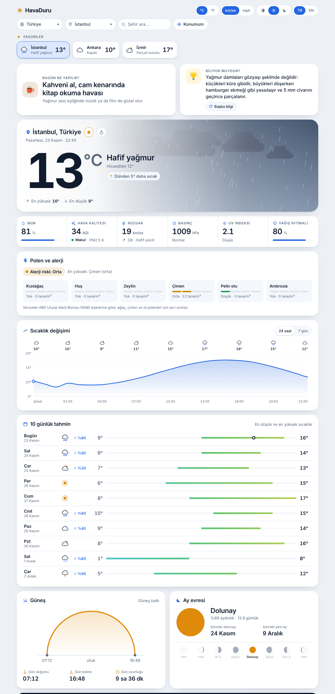
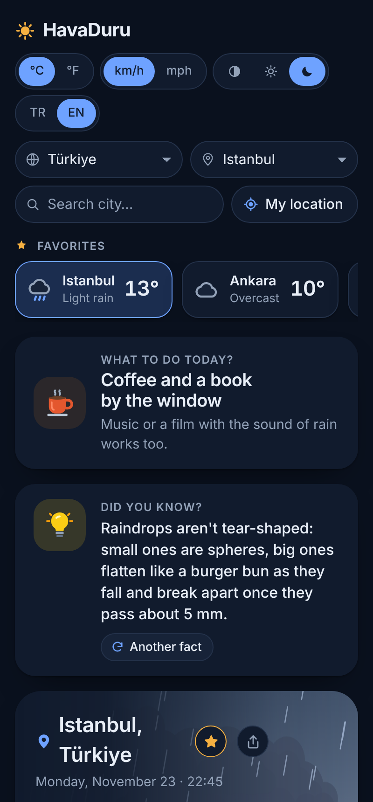
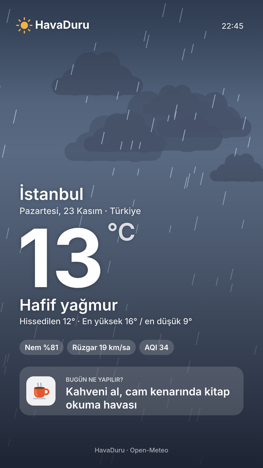
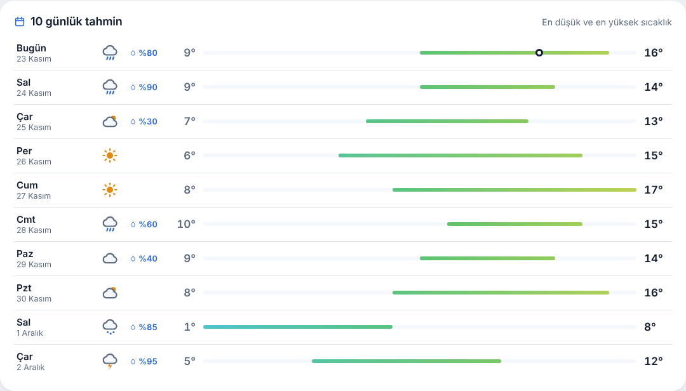
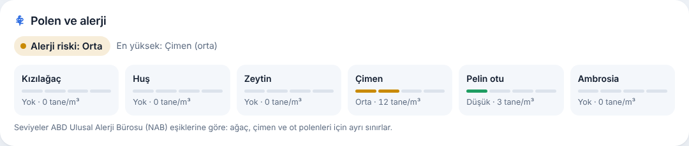
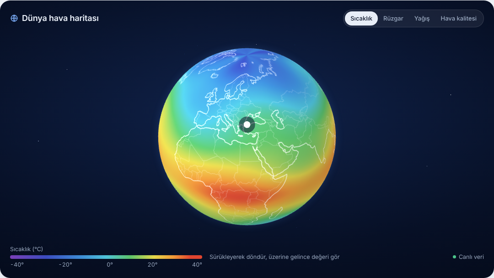

# HavaDuru

Modern, tek dosyalık bir hava durumu sitesi. Canlı hava durumu, 10 günlük tahmin, polen ve alerji seviyesi, 3B dünya hava haritası, yağış radarı, aktivite önerileri ve paylaşılabilir hava kartı sunar. Kurulum ya da API anahtarı gerekmez.

**Canlı site:** https://muba14.github.io/havaduru/

  
  &nbsp;&nbsp;
  

> Ekran görüntüleri örnek veriyle alınmıştır; sitede gösterilen değerler Open-Meteo'dan canlı gelir.

## Özellikler

**Hava durumu**
- Ülke ve şehir seçimi (Türkiye'den 38 il dahil 16 ülke) ve dünyadaki tüm şehirlerde arama
- "Konumum" düğmesi: tarayıcı konumuyla bulunduğun yerin havası (izin istenir)
- Büyük derece göstergesi ve havaya göre değişen hareketli gökyüzü sahnesi: güneş, bulut, yağmur, şimşek, kar, sis, gece yıldızları ve hilal
- Dünle karşılaştırma ("Dünden 3° daha sıcak")
- Nem, hava kalitesi (AQI), rüzgar, basınç, UV indeksi ve yağış ihtimali
- 24 saatlik ve 7 günlük sıcaklık grafiği
- 10 günlük tahmin: her gün için hava simgesi, yağış ihtimali ve renkli en düşük–en yüksek sıcaklık çubuğu
- Polen ve alerji seviyesi: kızılağaç, huş, zeytin, çimen, pelin otu ve ambrosia (yalnızca Avrupa)
- Gün doğumu / gün batımı yayı ve ay evresi

**Öneriler ve bilgiler**
- "Bugün ne yapılır?" kartı: hava ve dereceye göre renkli simgeli aktivite önerisi
- "Biliyor muydun?" kartı: havaya uygun 31 ilginç bilgi (yağmur damlasının hızı, dünya sıcaklık rekorları, en uzun şimşek…)

**Haritalar**
- 3B dünya küresi: sıcaklık, rüzgar, yağış ve hava kalitesi katmanları; sürükleyerek döndürme, üzerine gelince değer gösterme
- Yağış radarı: son 2 saatin yağışını harita üzerinde oynatma

**Kişiselleştirme**
- En fazla 5 favori şehir
- °C / °F ve km/sa / mph
- Türkçe / İngilizce
- Açık, koyu ya da cihazın teması

**Kullanım kolaylığı**
- Mikro animasyonlar: şehir değişince gökyüzü sahnesi yumuşakça geçiş yapar, sayılar akarak değişir
- Klavye ile gezinme: <kbd>/</kbd> arama, <kbd>K</kbd> konum, <kbd>F</kbd> favori, <kbd>P</kbd> paylaş; arama sonuçlarında ve seçeneklerde ok tuşları; küreyi ok tuşlarıyla döndürme; "İçeriğe geç" bağlantısı
- Hareketi azaltma ayarı açıksa animasyonlar kapanır

**Paylaşım**
- Hikaye (9:16) ve kare (1:1) boyutlarında PNG hava kartı; telefonda doğrudan Instagram ya da WhatsApp'a paylaşma

## Çalıştırma

Kurulum gerekmez. `index.html` dosyasını tarayıcıda açman yeterli.

## GitHub Pages ile yayınlama

1. Bu dosyaları `havaduru` adlı deponun kök dizinine yükle.
2. Depoda **Settings → Pages** bölümüne gir.
3. **Source** olarak `Deploy from a branch`, dal olarak `main`, klasör olarak `/ (root)` seç ve kaydet.
4. Birkaç dakika sonra site `https://muba14.github.io/havaduru/` adresinde açılır.

Site statik olduğu için derleme adımı ya da GitHub Actions iş akışı gerekmez.

## Dosyalar

| Dosya | Açıklama |
|---|---|
| `index.html` | Sitenin tamamı (HTML, CSS, JavaScript ve dünya haritası çizgileri tek dosyada) |
| `assets/` | README ekran görüntüleri |
| `.nojekyll` | GitHub Pages'in dosyaları olduğu gibi sunmasını sağlar |

## Kullanılan servisler ve kütüphaneler

| Ne için | Kaynak | Not |
|---|---|---|
| Hava tahmini, dünle karşılaştırma, küre verisi | [Open-Meteo Forecast API](https://open-meteo.com/) | Ücretsiz, anahtarsız (ticari olmayan kullanım), CC BY 4.0 |
| Hava kalitesi ve polen | [Open-Meteo Air Quality API](https://open-meteo.com/en/docs/air-quality-api) | Polen verisi yalnızca Avrupa için |
| Konumdan şehir adı | [BigDataCloud Reverse Geocoding (client)](https://www.bigdatacloud.com/free-api/free-reverse-geocode-to-city-api) | Ücretsiz, anahtarsız, tarayıcıdan kullanım |
| Şehir arama | [Open-Meteo Geocoding API](https://open-meteo.com/en/docs/geocoding-api) | |
| Yağış radarı | [RainViewer Weather Maps API](https://www.rainviewer.com/api.html) | Kişisel/eğitim amaçlı ücretsiz; en fazla 7. yakınlaştırma, dakikada 100 istek |
| Harita zemini | [CARTO](https://carto.com/attributions) / [OpenStreetMap](https://www.openstreetmap.org/copyright) | |
| Harita | [Leaflet](https://leafletjs.com/) 1.9.4 | BSD-2 |
| 3B küre | [three.js](https://threejs.org/) r128 | MIT |
| Kıyı ve sınır çizgileri | [Natural Earth](https://www.naturalearthdata.com/) ([world-atlas](https://github.com/topojson/world-atlas)) | Kamu malı |

Notlar:
- Dünya küresi verisi, dünyaya 15 derece arayla yayılmış 264 noktadan tek istekte çekilir ve tarayıcıda 1 saat saklanır.
- Ay evresi cihazda hesaplanır.
- Polen seviyeleri ABD Ulusal Alerji Bürosu (NAB) eşiklerine göre hesaplanır.
- Konum özelliği yalnızca HTTPS üzerinden çalışır; GitHub Pages bunu sağlar.
- API'lere ulaşılamazsa site, üstte belirterek örnek veri gösterir.
